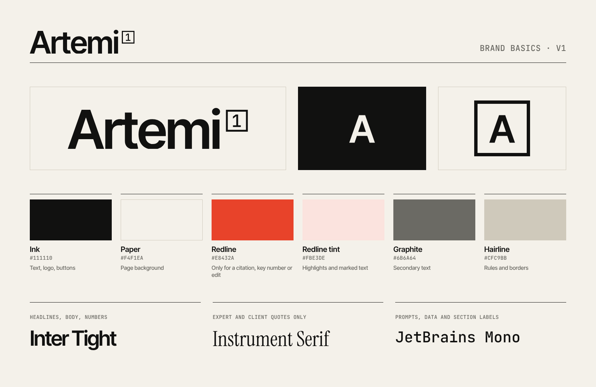

# Artemi brand basics

## The logo

**Wordmark:** "Artemi" followed by a boxed **1**, the footnote marker AI answers put
next to their first source. It reads as *Artemi, source [1]*: the brand that gets cited.

**Icon:** the same citation box with the **A** inside. Use it where space is square or
small: favicon, LinkedIn profile, app icons.

The logo is drawn from Inter Tight SemiBold and JetBrains Mono outlines, so the SVGs
display correctly without any fonts installed.

| File | Use |
|---|---|
| `logo/artemi-wordmark-ink.svg` / `.png` | Default, on light backgrounds |
| `logo/artemi-wordmark-paper.svg` / `.png` | On Ink or dark photos |
| `logo/artemi-wordmark-ink-on-paper.*`, `-paper-on-ink.*` | With background, e.g. slides, documents |
| `icons/artemi-icon-ink.*` | Default icon (solid Ink square) |
| `icons/artemi-icon-paper.*` | Outline icon on light backgrounds |
| `social/linkedin-banner-1584x396.png` | LinkedIn company page banner |
| `social/linkedin-profile-400x400.png` | LinkedIn / social profile image |
| `social/og-share-1200x630.png` | Link preview image (also used by the website) |

PNG logos come at 120px and 240px tall (`-120h`, `-240h`). Use SVG wherever possible.

### Rules
- **Ink or Paper only.** Never Redline, never a gradient, never on a busy photo.
- **Clear space:** keep empty space around the logo at least the height of the boxed 1.
- **Minimum size:** wordmark 18px tall on screen; below that, use the icon.
- Don't stretch, rotate, outline, add effects, or remove the boxed 1 from the wordmark.

## Colour

| Name | Hex | Use |
|---|---|---|
| Ink | `#111110` | Text, logo, buttons |
| Paper | `#F4F1EA` | Page background (every surface) |
| Redline | `#E8432A` | **Only** to mark what matters: a citation, a key number, an edit |
| Redline tint | `#FBE3DE` | Highlights and marked text |
| Graphite | `#6B6A64` | Secondary text |
| Hairline | `#CFC9BB` | Rules and borders |

No other colours. Redline is never decoration, including in the logo.

## Type

| Font | Use |
|---|---|
| Inter Tight | Headlines, body, numbers. Large headlines with tight letter spacing. |
| Instrument Serif | Expert and client quotes only |
| JetBrains Mono | AI prompts, data labels, section labels (e.g. `01 / AI search`) |

All three are free on Google Fonts.

## Imagery
Real artefacts only: AI answer panels, citation counts, annotated drafts.
No stock photos, gradients, glowing shapes, 3D or robot imagery.
